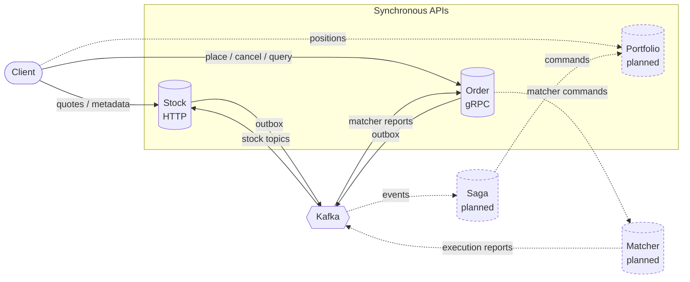

# TradingSystem

[](https://github.com/KeqJiil/TradingSystem/actions/workflows/ci.yml)

A learning and portfolio project: a trading platform built as independent .NET microservices that talk over Kafka. It exists to practise the patterns used in distributed systems in production — transactional outbox/inbox, event sourcing, CQRS with read models, reliable messaging, and (next) a matching engine as a separate process.

> The project is under active development. The status below is what actually exists in the repository today.

## Status

| Component | Responsibility | Status |
|---|---|---|
| **Stock** | Instruments, metadata, price (event-sourced), hourly and daily OHLC candles | 🟢 Feature-complete (HTTP API) |
| **Order** | Order lifecycle: placing, cancel requests, fills, expiry; gRPC API | 🟡 Persistence, gRPC + JWT, Kafka consumers and outbox/inbox done; instrument model still on a `Symbol` enum |
| **Messaging** (shared library) | Kafka producer/consumer host, outbox, inbox, retries, DLQ, cleanup | 🟢 In use by Stock and Order; per-key outbox ordering and metrics in progress |
| **Contracts** | Schema-first protobuf event and service contracts | 🟢 In use; Order request contracts being reworked |
| **Matcher** | Order book and matching; the future price source | ⚪ Design in progress |
| **Portfolio** | Positions, balances, portfolio value | ⚪ Planned |
| **Saga** | Orchestration of *place order → reserve funds → update portfolio* with compensations | ⚪ Planned |
| **Identity** | Authentication and authorization (likely Keycloak) | ⚪ Planned |

## Architecture



Every service owns its database. State changes and their outgoing messages are written in the same transaction (outbox); incoming messages are deduplicated (inbox) where the service needs it. Kafka messages are keyed so that per-entity order is preserved: `order-events-topic` is keyed by `OrderId`, and the planned `matcher-commands-topic` is keyed by instrument.

Stock is not a saga participant: it publishes price and metadata events, and other services keep local replicas of them.

## Tech stack

- **.NET 10** and C#
- **ASP.NET Core** — minimal-API endpoints in Stock, **gRPC** (`Grpc.AspNetCore`, HTTP/2, server reflection in development) in Order, JWT bearer authentication in Order
- **Protocol Buffers** (`Google.Protobuf`, `Grpc.Tools`) — schema-first contracts in [src/Contracts](src/Contracts); C# classes are generated at build time
- **MediatR** — CQRS handlers with tracing, validation and resilience pipeline behaviours
- **FluentValidation** — command validation in Stock
- **Apache Kafka** (`Confluent.Kafka`) — asynchronous messaging, retry and dead-letter topics
- **MS SQL Server** — **Dapper** and **DbUp** in Stock and in the messaging library; **Entity Framework Core** in Order
- **Hangfire** — cron-scheduled candle jobs in Stock
- **Polly** — resilience around transient SQL errors
- **OpenTelemetry** — traces, metrics and logs; correlation id on top of W3C trace context; Aspire dashboard for local viewing
- **xUnit**, **Testcontainers** (SQL Server, Kafka) — integration tests against real dependencies
- **Docker Compose** — local infrastructure and services

## Repository layout

```
src/
├── Contracts/                 # protobuf contracts (schema is the source of truth)
├── Services/
│   ├── Stock/                 # Stock service (HTTP, Dapper, event store, read models)
│   ├── Stock.Tests/
│   ├── Order/                 # Order service (gRPC, EF Core, DDD aggregate)
│   ├── Order.Tests/
│   ├── Messaging.Abstractions/  # consumer, middleware and serializer contracts
│   ├── Messaging/             # Kafka host, topics, publishing and consuming pipelines
│   ├── Messaging.Dapper/      # outbox / inbox / unit of work on Dapper
│   ├── Messaging.EFCore/      # outbox / inbox / cleanup on EF Core
│   ├── Messaging.Testing/     # SQL Server and Kafka fixtures for service tests
│   └── Messaging*.Tests/      # library tests
compose.yaml                   # local infrastructure and services
```

## Stock service

Stock is the first service and the place where the patterns for the others were worked out.

- **Event sourcing for price only** — `events_store` is an append-only log of price deltas. Instrument metadata (name, currency, trading hours, open-to-trade flag) is state-based with a monotonic `metadata_version`.
- **Transactional outbox** — changes and their messages are written in one transaction through the shared messaging library.
- **CQRS with an asynchronous read model** — Stock consumes its own topics to build `stock_data_projection`: last-writer-wins per metadata field, version checks for price, and gaps filled inline by replaying `events_store`.
- **OHLC candles** — hourly and daily candles by event time, built by Hangfire jobs and immutable once written.
- **Idempotency without an inbox** — domain versions and natural keys make redelivery safe.
- **Unit of work** — optimistic concurrency, and retry of the whole transaction on transient SQL errors.
- **Observability** — correlation id, W3C trace context across HTTP, outbox, Kafka and Hangfire; health checks at `/health/live` and `/health/ready`.
- **Versioned migrations** — 15 sequential DbUp scripts in [Migrations](src/Services/Stock/Infrastructure/Persistence/Migrations).

HTTP API under `/api/v1/stocks`:

| Method | Route | Purpose |
|---|---|---|
| `PUT` | `/{id}` | Create a stock (idempotent) |
| `PATCH` | `/{id}/name` | Change name |
| `PATCH` | `/{id}/trading-time` | Change trading hours |
| `PUT` | `/{id}/open-to-trade` | Set open-to-trade flag |
| `GET` | `/{id}/metadata` | Metadata |
| `GET` | `/{id}` | Current state, including price |
| `GET` | `/{id}/prices/hourly` | Hourly candles |
| `GET` | `/{id}/prices/daily` | Daily candles |
| `GET` | `/{id}/prices/daily/{date}` | Daily candle for one date |

Example requests are in [Stock.http](src/Services/Stock/Stock.http).

## Order service

Order accepts and tracks orders. It has no HTTP API; clients use gRPC.

Implemented:

- **Domain model** — `Order` aggregate with the lifecycle *PendingNew → New → PartiallyFilled → Filled*, plus reject, cancel request and cancel rejection, cancel, and expiry. Value objects `Price`, `Quantity`, `OrderTerms` (market / limit, time in force) and the `Fill` entity. `ApplyFillSpecification` validates fills. Results are returned instead of exceptions.
- **Persistence** — EF Core with a `MessagePublishingInterceptor`, so domain events go into the outbox on `SaveChanges`. Migrations apply on start.
- **gRPC API** — `OrderService` with `CreateOrder`, `RequestOrderCancel`, `GetById` and `GetListByUserId`. Bearer JWT authentication; the user id is taken from the token.
- **Messaging** — publishes order events to `order-events-topic` (keyed by `OrderId`, protobuf). Consumes matcher execution reports (`OrderAccepted`, `OrderRejected`, `Fill`, `OrderExpired`, `OrderCanceled`, `CancelRejected`) from `matcher-execution-reports-topic` in consumer group `order-execution-reports-group`.
- **Observability** — OpenTelemetry tracing and metrics, correlation middleware, Kafka health check.

Planned for Order:

- Instrument identifier is still a `Symbol` enum; it is moving to a `StockId` value object (Stock's Guid).
- `ClientOrderId` for idempotent order placement, and `DbUpdateConcurrencyException` mapped to `Aborted` on cancel requests.
- Matcher commands (`matcher-commands-topic`) in place of the current direct order flow.

## Messaging library

A shared library in `src/Services/Messaging*` used by every service.

- **Messaging** — Kafka producer and consumer host, topic registration, publish and consume middleware (logging, tracing, exception handling), retries and dead-letter topics, outbox relay.
- **Messaging.Abstractions** — consumer, middleware, publisher and serializer contracts.
- **Messaging.Dapper** — outbox, inbox, unit of work with transient-error retry, cleanup jobs and migrations for the `messaging` schema.
- **Messaging.EFCore** — the same outbox, inbox and cleanup on top of EF Core.
- **Messaging.Testing** — SQL Server and Kafka fixtures, and `Published.OfTypeAsync<T>` for asserting published messages in service tests.

In progress: keeping per-key order in the outbox (a row is claimed only when no earlier row with the same topic and key is pending), and Messaging metrics (age of the oldest pending outbox row, relay throughput, handler duration, retry and DLQ counters).

## Topics

| Topic | Key | Producer | Consumer |
|---|---|---|---|
| `stock-created-topic` | StockId | Stock | Stock |
| `stock-status-toggled-topic` | StockId | Stock | Stock |
| `price-topic` | StockId | Stock | Stock |
| `price-change-requested-topic` | StockId | Stock | Stock |
| `stock-name-changed-topic` | StockId | Stock | Stock |
| `stock-trading-time-changed-topic` | StockId | Stock | Stock |
| `order-events-topic` | OrderId | Order | Saga (planned) |
| `matcher-commands-topic` | instrument id | Order | Matcher (planned) |
| `matcher-execution-reports-topic` | not fixed yet | Matcher (planned) | Order |

Event contracts are protobuf. Stock's topics are consumed by Stock itself; the Order and matcher topics are shared between services.

## Running locally

Requirements: Docker and the .NET 10 SDK.

Create a `.env` file next to `compose.yaml`:

```dotenv
MSSQL_STOCK_PASSWORD=<sa password for stock-db>
ConnectionStrings__DefaultConnection=Server=stock-db,1433;Database=StockDb;User Id=sa;Password=<sa password for stock-db>;TrustServerCertificate=True

MSSQL_ORDER_PASSWORD=<sa password for order-db>
ConnectionStrings__OrderDbConnectionString=Server=order-db,1433;Database=OrderDb;User Id=sa;Password=<sa password for order-db>;TrustServerCertificate=True
ORDER_JWT_SIGNING_KEY=<base64-encoded symmetric key, at least 32 bytes>
```

Start everything:

```bash
docker compose up -d
```

Add `--profile observability` to also start the Aspire dashboard.

| Endpoint | URL |
|---|---|
| Stock HTTP API | `http://localhost:8081` |
| Order gRPC | `http://localhost:8083` (HTTP/2) |
| Order health | `http://localhost:8082/health/ready` |
| Aspire dashboard | `http://localhost:18888` (with `--profile observability`) |
| Kafka (from host) | `localhost:9092` |
| Stock SQL Server | `localhost:1434` |
| Order SQL Server | `localhost:1435` |

Order expects JWTs with issuer `dotnet-user-jwts`, audience `http://localhost:5026`, signed with the key from `ORDER_JWT_SIGNING_KEY`. The user id is read from the `sub` claim. Services apply their own migrations on startup.

To run a service on the host instead of in a container, start only the infrastructure (`docker compose up -d kafka stock-db order-db`) and replace the container host names in the connection strings with `localhost,1434` (Stock) or `localhost,1435` (Order).

## Tests

Integration tests start SQL Server and Kafka in containers through Testcontainers, so Docker must be running.

```bash
dotnet build TradingSystem.slnx
dotnet test TradingSystem.slnx
```

Without Docker, the Order domain and mapping tests can still run:

```bash
dotnet test src/Services/Order.Tests --filter "FullyQualifiedName~Domain|FullyQualifiedName~Translator"
```

CI runs build and tests on every push to `main` and on pull requests (see [.github/workflows/ci.yml](.github/workflows/ci.yml)).

## Conventions

- Handlers return `Result` / `Result<T>`; callers map the error type to an outcome (Kafka consume outcome, HTTP or gRPC status). Exceptions are not used for expected failures.
- Tests use real dependencies (SQL Server and Kafka through Testcontainers, real persistence implementations), not mocks.
- Test names follow `Method_Condition_Expected`.

## What's next

1. Finish the Order contract rework: instrument id as `StockId`, client order id for idempotent placement.
2. Outbox per-key ordering, then Messaging metrics.
3. Matcher: design of order book, commands and reports, then implementation in slices (order book → Kafka → integration with Order and Stock → end-to-end test).
4. Portfolio, Identity, and deployment.

Deferred: reconciliation of stuck orders (needs the matcher), authentication in Stock (needs Identity), and redrive of messages from the dead-letter topics.

## License

MIT — see [LICENSE](LICENSE).
